# Study Tracker / Konkur — Database Architecture

## Stack

| Layer | Choice |
|-------|--------|
| Framework | Django 6.1 + Django REST Framework |
| Database | PostgreSQL 14+ |
| ORM | Django ORM |
| Auth user | `accounts.User` (UUID PK, `AbstractUser`) |
| Money | Integer minor units + ISO 4217 currency codes |
| Time | UTC storage (`USE_TZ=True`), IANA timezone on user settings |

## Design principles

- Normalized relational schema with explicit FKs and check constraints.
- Multi-role accounts via `roles` / `user_roles` / `permissions` (not a single enum on users).
- International education hierarchy (country → system → institution → program/exam).
- Raw events (sessions, messages, XP ledger) separate from derived aggregates (daily summaries, leaderboard snapshots).
- Soft delete only where content recovery or moderation warrants it; financial/legal rows are retained.
- Organization/school tenancy via explicit membership tables; no shared global assumptions.
- Persian/RTL is a UI concern; DB stores UTF-8 text, locales, and translation rows for dynamic content.

## Module map

| App | Domains |
|-----|---------|
| `common` | Shared mixins / base abstract models |
| `accounts` | Users, profiles, settings, roles, devices, tokens, privacy, blocks |
| `education` | Countries, systems, institutions, subjects, exams, user education profiles |
| `study` | Sessions, goals, plans, tests/questions, analytics aggregates |
| `social` | Follows, posts, communities, challenges, rankings, XP, achievements |
| `coaching` | Coach marketplace, CRM, packages, assignments, meetings |
| `org` | Parents, schools, organizations, teachers, institutional assignments |
| `messaging` | Conversations, messages, notifications, push devices |
| `safety` | Reports, moderation, sanctions, integrity flags, audit logs |
| `portfolio` | Academic passport, certificates, shareable cards |
| `billing` | Plans, subscriptions, payments, wallets, referrals |
| `platform` | Settings, feature flags, locales, currencies, job checkpoints |

## Source of truth vs derived

| Source of truth | Derived / cached |
|-----------------|------------------|
| `study_sessions`, session events | `daily_study_summaries`, heatmaps, streak records |
| `xp_transactions` | `user_levels.current_xp` (reconcile from ledger) |
| `wallet_transactions` | `coach_wallets.balance_minor` |
| `challenge_progress` / session metrics | `leaderboard_snapshots` |
| Raw posts / memberships | `activity_feed_items` |

Aggregation jobs must be idempotent via `scheduled_job_checkpoints` / unique period keys.

## Privacy highlights

- Coach private notes: coach-student scoped; never exposed to student/parent APIs.
- Parent access: only via `parent_child_relationships` + `parent_permissions`.
- Messages: participants only; no automatic parent/teacher visibility.
- Social posts: respect `visibility` and block/mute tables.
- Soft-deleted content remains hidden from public queries.

## Deletion policy

| Data | Policy |
|------|--------|
| Study sessions, goals | Soft-delete optional; hard-delete on confirmed account purge after retention |
| Messages / posts | Soft-delete; purge per retention policy |
| Payments, invoices, wallets | Retain for legal/compliance; anonymize PII on account deletion |
| Audit / moderation | Retain |

## ER overview (implemented core)

```mermaid
erDiagram
  User ||--o{ UserRole : assigned
  Role ||--o{ UserRole : grants
  Role ||--o{ RolePermission : includes
  Permission ||--o{ RolePermission : defines
  User ||--|| UserProfile : has
  User ||--|| UserSettings : has
  User ||--|| UserPrivacySettings : has
  User ||--o{ UserBlock : blocks
  User ||--o{ UserEducationProfile : studies
  Country ||--o{ EducationSystem : defines
  EducationSystem ||--o{ Institution : contains
  EducationSystem ||--o{ Subject : catalogs
  Exam ||--o{ ExamSubject : includes
  User ||--o{ UserExamRegistration : registers
  User ||--o{ StudySession : logs
  User ||--o{ Goal : owns
  StudySession }o--o| Subject : about
  StudySession ||--o{ StudySessionEvent : emits
  Goal }o--o| Exam : targets
  User ||--o{ Follow : follows
  User ||--o{ Post : authors
  Post }o--o| Community : scoped
  Community ||--o{ CommunityMembership : has
  User ||--o{ ActivityFeedItem : receives
  CoachProfile ||--o{ CoachStudentRelationship : coaches
  CoachProfile ||--o{ CoachNote : writes
  CoachStudentRelationship ||--o{ CoachReview : enables
  User ||--o{ ParentChildRelationship : parent_of
  ParentChildRelationship ||--o{ ParentPermission : grants
  Organization ||--o{ OrganizationMembership : has
  Organization ||--o{ School : owns
  School ||--o{ TeacherProfile : employs
  TeacherProfile ||--o{ TeacherClassAssignment : teaches
  Conversation ||--o{ ConversationParticipant : includes
  Conversation ||--o{ Message : contains
  User ||--o{ XpTransaction : earns
  CoachWallet ||--o{ WalletTransaction : ledger
  PaymentCustomer ||--o{ PaymentTransaction : charges
  PaymentTransaction ||--o{ MarketplaceOrder : settles
```



Cardinality notes:
- One user → many roles (`UserRole` unique per pair; one active primary).
- One student → many coaches (partial unique active pair).
- One parent → many children via `ParentChildRelationship` (unique pair).
- One live study session per user (`active`/`paused`, not soft-deleted).
- Blocks: `accounts.UserBlock` only (safety.BlockedUser removed).

See also [database-audit-report.md](database-audit-report.md).

## Analytics aggregation strategy

1. Write path updates raw `study_sessions` / session events transactionally.
2. Idempotent jobs keyed by `study.AnalyticsJobCheckpoint` / `platformcfg.ScheduledJobCheckpoint` roll into `daily_study_summaries`, heatmaps, and streaks.
3. Rankings read `leaderboard_snapshots` / entries, not full session scans.
4. XP balance on `UserLevel` reconciles from `XpTransaction` ledger.
5. Wallet balance reconciles from `WalletTransaction` ledger.

## Authorization data-layer helpers

See `common/access.py`:

- `parent_can_view_child` — relationship + permission gate
- `coach_notes_queryset_for_user` — coach-only private notes
- `conversation_messages_for_participant` — participant-only messages

## Operations

```bash
cd ~/Desktop/konkur-back
source .venv/bin/activate
cp .env.example .env   # set DATABASE_URL
python manage.py migrate
python manage.py seed_dev
python manage.py test accounts study social billing
```

## Migration status

Initial migrations applied successfully against PostgreSQL database `konkur` (`DATABASE_URL`).
